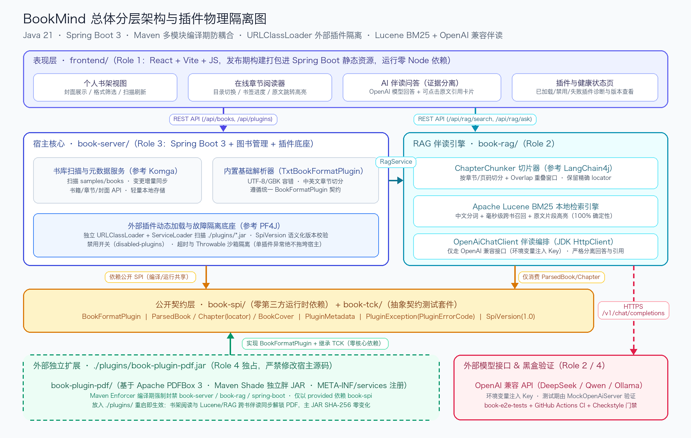
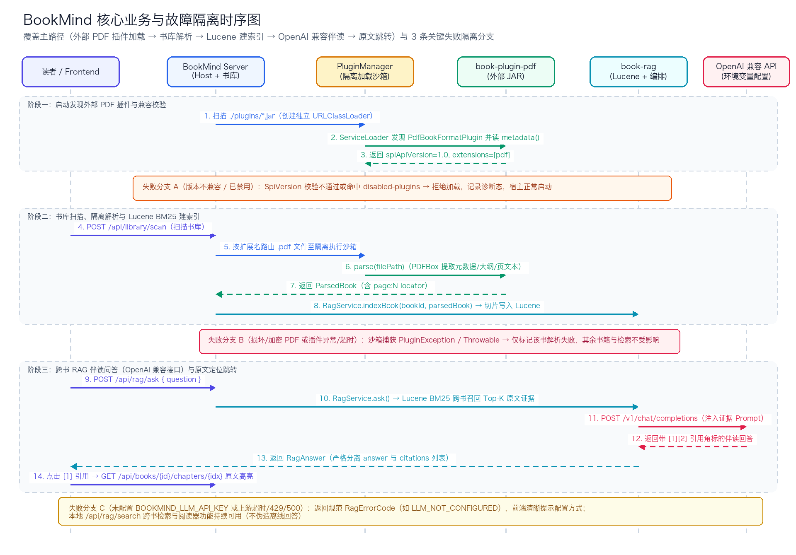

# BookMind——系统设计文档

> **文档状态说明**：本文档为开发初期系统设计稿（对应仓库初始骨架 `v0.1.0-SNAPSHOT`）。文中接口契约（`book-spi`、`book-tck`、`book-rag` 契约模型）、多模块工程边界、配置项与 CI 门禁**已在仓库中落盘并验证通过**；标有「计划实现（对应 PR 编号）」的业务模块将由 4 位成员在后续小 PR 中分阶段交付，并随实现同步修订本文档，确保最终提交版本与代码 100% 一致。

---

## 1. 项目概述与需求

### 1.1 目标用户与核心痛点

BookMind 是一款面向**普通读者、大学生与科研学习者**的本地私人电子书库与 AI 伴读 Web 服务。在日常阅读与课程学习中，用户普遍面临三个真实痛点：

1. **资料散落、缺乏书架与阅读体验**：电脑硬盘里散落着 TXT 书籍、PDF 教材与论文讲义，缺乏统一书架封面、目录导航和进度管理；
2. **跨书查概念耗时且难核对来源**：面对多本教材或长篇资料，系统自带文件名搜索无法深入正文，而直接向通用大模型提问又极易产生幻觉、无法回到教材原文核验；
3. **格式扩展与核心系统耦合严重**：传统单体重型阅读软件新增一种电子书格式往往需要改动核心源码并重新打包，且单本损坏文件或畸形解析器极易拖垮整个服务。

### 1.2 核心使用场景（一句话定义）

**大学生或普通读者在本地整理个人电子书与课程教材时，使用 BookMind 扫描本地书库目录，在浏览器中完成书架管理、在线分章阅读与基于 OpenAI 兼容接口的跨书 RAG 伴读问答，并通过独立接入外部 PDF 插件零改动扩展新格式能力。**

完整端到端路径：`本地书库目录 + 用户提问/阅读选择` → `Spring Boot 宿主调度（内置 TXT + 外部隔离 PDF 插件）→ 书库管理与 Lucene 切片索引` → `可核对的书架/章节正文 + 严格分离的伴读回答与可点击原文引用` → `清晰的错误码与隔离诊断反馈`。

### 1.3 功能范围边界

| 维度 | 本期实现范围 | 本期明确不做（Out of Scope） |
| --- | --- | --- |
| **核心基础能力** | 本地书库目录扫描与轻量元数据管理；内置 TXT 编码容错与智能分章解析器（`TxtBookFormatPlugin`）；浏览器书架与章节阅读器；基于 Apache Lucene BM25 的本地全文检索与精确溯源；基于 OpenAI 兼容接口（环境变量注入 Key）的跨书 RAG 伴读问答与原文跳转高亮 | 多用户注册/登录与 RBAC 权限体系；重型外部数据库（MySQL/PostgreSQL）；重型向量数据库（Milvus/Qdrant）与百兆级本地 Embedding 模型；伪离线生成/离线拼接回答模式 |
| **扩展能力** | 统一 `BookFormatPlugin` 公开 SPI（版本 `1.0`）、基于 `URLClassLoader + ServiceLoader` 的外部 `./plugins/*.jar` 隔离加载底座，以及 **1 个独立扩展模块** `book-plugin-pdf`（基于 Apache PDFBox 解析可选中文本型 PDF） | 插件市场/商店；运行时不停机热卸载（允许放入/移除插件 JAR 后重启生效）；多种扩展机制并存；扫描版图片 PDF 的 OCR 识别 |
| **交互与交付** | React + Vite + JS 单页应用（发布期编译打入 Spring Boot 静态资源）；单包 `java -jar` 一键本地运行；Checkstyle + Maven Enforcer + Vitest + GitHub Actions CI | 云端集群部署、Kubernetes、Docker 强依赖、复杂移动端原生 App |

### 1.4 核心场景完成条件（Acceptance Criteria）

1. **基础闭环可用**：在 `./plugins/` 为空时，启动 BookMind 并扫描 `samples/books/`，书架正确展示内置 TXT 样书并可在线分章阅读，Lucene 检索可精确命中指定章节；配置 OpenAI 兼容环境变量后（或测试期对接本地 `MockOpenAiServer`），伴读问答返回带 `[1]` 角标的回答及独立可跳转的原文引用列表。
2. **独立扩展增量可核对**：独立构建 `book-plugin-pdf.jar` 并放入 `./plugins/` 重启服务后，**核心源码零修改、宿主主 JAR 的 SHA-256 字节零变化**，同一书库目录立刻同时解锁 PDF 书架阅读与跨 TXT+PDF 的统一 RAG 检索和伴读问答。
3. **故障与禁用行为符合声明**：通过配置禁用 `pdf-pdfbox`、移除插件 JAR、放入损坏/加密 PDF、加载不兼容 SPI 版本插件或未配置 `BOOKMIND_LLM_API_KEY` 时，系统均返回文档声明的规范错误码，不崩溃、不影响既有书库浏览与本地检索。

---

## 2. 总体架构

### 2.1 分层架构与物理隔离设计

BookMind 采用 **Maven 多模块 + 前后端一体发布** 架构。整个工程被划分为 6 个职责单一的 Maven 模块与 1 个前端模块，通过编译期 Maven 依赖拓扑 + Enforcer 规则与运行期独立 `URLClassLoader` 双重防线，彻底杜绝扩展模块反向耦合宿主内部实现。



### 2.2 依赖方向与核心边界规则

1. **契约倒置（Dependency Inversion）**：`book-spi` 处于最底层且**零第三方运行时依赖**。宿主 `book-server`、检索引擎 `book-rag` 与独立扩展 `book-plugin-pdf` 均单向依赖 `book-spi`。
2. **编译期物理防线**：`book-plugin-pdf/pom.xml` 中以 `<scope>provided</scope>` 声明 `book-spi`，并通过 `maven-enforcer-plugin` 的 `bannedDependencies` 规则**强制封禁** `io.bookmind:book-server`、`io.bookmind:book-rag` 与 `org.springframework.boot:*`。即便误写一条对核心内部类的 `import`，在 `mvn compile` 阶段即会失败。
3. **运行期独立胖 JAR 与类加载边界**：`book-plugin-pdf` 使用 `maven-shade-plugin` 将自身私有依赖（Apache PDFBox 及其传递依赖）打入独立插件 JAR，自动排除 `provided` 范围的 `book-spi`，并保留 `META-INF/services/io.bookmind.spi.BookFormatPlugin`。运行期宿主以 `BookFormatPlugin.class.getClassLoader()` 为父加载器为外部插件构建独立 `URLClassLoader`，既确保插件与宿主共享同一份 `book-spi` 类型（避免 `ClassCastException`），又让宿主主 JAR 完全不需要引入 PDFBox 依赖。
4. **单扩展机制双端赋能**：所有内置与外部格式插件统一输出标准不可变模型 `ParsedBook`（含 `List<Chapter>` 与统一 `locator`）。`book-server` 收到解析结果后同时更新书架元数据并调用 `RagService.indexBook(bookId, parsedBook)`，因此新增任何格式插件都会自动同时解锁在线阅读与跨书 RAG 伴读，无需新增第二套 RAG Connector 扩展机制。

### 2.3 开源架构借鉴与裁剪说明

本项目全部源码由团队原创实现，核心架构设计重点参考了以下宽松协议的成熟 Java/JVM 开源项目并做了轻量化裁剪：

| 借鉴开源项目 | 许可证 | 借鉴的核心设计思想 | 本项目的轻量化裁剪 |
| --- | --- | --- | --- |
| **Komga** | MIT | 书库目录扫描器、统一书籍/章节/封面元数据管理模型 | 去除多用户、外部数据库与漫画转码，聚焦轻量本地书库扫描与元数据索引 |
| **PF4J** | Apache-2.0 | `PluginClassLoader` 类加载隔离、`PluginDescriptor` 元数据与版本兼容检查 | 不引入完整框架黑盒，用纯 JDK `URLClassLoader + ServiceLoader` 实现百行级透明可控底座 |
| **Apache Lucene** | Apache-2.0 | 工业级 BM25 全文检索、中文分词与高亮片段提取 | 直接作为 `book-rag` 核心依赖，以本地目录索引提供毫秒级确定性检索 |
| **LangChain4j** | Apache-2.0 | `DocumentSplitter` 重叠窗口切片思想与检索/对话编排分层 | 去除多模型重型抽象，用 JDK 21 原生 `HttpClient` 实现极简 OpenAI 兼容客户端 |
| **Apache PDFBox** | Apache-2.0 | 文本型 PDF 文档加载、大纲/分页文本提取与封面渲染 | 封装在独立扩展 `book-plugin-pdf` 内部，宿主完全零感知 |

---

## 3. 模块设计

### 3.1 模块总览与团队职责映射

| 模块目录 | 归属角色 | 当前状态 | 核心职责 | 关键对外接口 / 产物 |
| --- | --- | --- | --- | --- |
| `book-spi/` | Role 3 主导（四人评审） | **已落盘并通过单测** | 定义不可变公开插件契约、错误码与语义化 SPI 版本校验 | `BookFormatPlugin`、`ParsedBook`、`Chapter`、`BookCover`、`PluginException`、`SpiVersion` |
| `book-tck/` | Role 3 | **已落盘可继承** | 提供可复用的抽象契约测试套件，约束所有内置与外部格式插件行为 | `AbstractBookFormatPluginContractTest` |
| `book-server/` | Role 3 | 骨架已可启动（PR-S1..S4 迭代） | Spring Boot 3 主应用、外部插件隔离底座、内置 TXT 解析、书库扫描持久化与 REST API | `BookMindApplication`、`HealthController`、`PluginManager`（计划）、`LibraryService`（计划） |
| `book-rag/` | Role 2 | 契约已落盘（PR-R1..R4 迭代） | 章节切片、Apache Lucene BM25 索引检索、OpenAI 兼容伴读客户端与严格溯源编排 | `RagService`、`TextChunk`、`SearchHit`、`Citation`、`RagAnswer`、`RagErrorCode` |
| `book-plugin-pdf/` | Role 4（严禁改核心） | 骨架已可独立打包（PR-P1..P2 迭代） | 基于 Apache PDFBox 3 的独立 PDF 格式解析插件（元数据/大纲/分页/封面/坏文件映射） | `PdfBookFormatPlugin`、`META-INF/services/...`、独立 Shade 插件 JAR |
| `book-e2e-tests/` | Role 4 | 骨架已建（PR-P3 迭代） | 外部 JAR 黑盒端到端集成测试（验证无插件、热接入、禁用、坏插件隔离） | `E2eBootstrapTest`、`ExternalPluginIsolationE2eTest`（计划） |
| `frontend/` | Role 1 | 骨架已过 Vitest（PR-F1..F4 迭代） | React + Vite + JS 单页阅读与伴读客户端（发布期编译入 Spring Boot 静态目录） | 书架、章节阅读器、证据分离 AI 伴读面板、插件状态面板 |

### 3.2 各核心子系统详细职责

#### 3.2.1 插件运行时底座（`book-server/src/main/java/io/bookmind/server/plugin/`，计划 PR-S1）
- `ExternalPluginLoader`：扫描 `bookmind.plugins-dir` 目录下的 `*.jar`，为每个插件 JAR 创建独立 `URLClassLoader`（父加载器显式传入 `BookFormatPlugin.class.getClassLoader()`），使用 `ServiceLoader.load(BookFormatPlugin.class, loader)` 发现实现类。
- `PluginRegistry`：维护内置插件与外部插件的注册表与状态枚举（`ACTIVE` / `DISABLED` / `INCOMPATIBLE` / `FAILED`），在加载前调用 `SpiVersion.isCompatibleWithHost(meta.spiApiVersion(), SpiVersion.CURRENT_API_VERSION)` 校验兼容性，并过滤 `bookmind.disabled-plugins` 名单。
- `PluginExecutionSandbox`：所有对 `plugin.parse(path)` 的调用均经由隔离沙箱执行：使用带超时的任务包装器（默认 `15000ms`），捕获 `PluginException` 原样透出，捕获任何未预期 `RuntimeException` 或 `LinkageError`/`Error`（除 `VirtualMachineError` 外）统一转为 `PluginException(PLUGIN_EXECUTION_FAILED, ...)`，确保单本畸形书籍或坏插件绝不拖垮宿主机和其他插件。

#### 3.2.2 书库管理与内置 TXT 解析（`book-server/.../library/` & `parser/txt/`，计划 PR-S2、PR-S3）
- `TxtBookFormatPlugin`：作为内置基础能力，实现同一套 `BookFormatPlugin` 接口并通过 `book-tck`。支持 UTF-8 / GBK 自动回退探测，按中英文章节标题正则（如 `第[零一二三四五六七八九十百千0-9]+[章节回]`、`Chapter \d+`）切分章节，若无明显章节标题则回退为单章节 `"全文"`，保证每本书至少包含 1 个带 `chapter:N` locator 的有效章节。
- `LibraryService`：遍历 `bookmind.library-dir`，按文件相对路径与 SHA-256 指纹识别新增/变更/删除书籍，将有效文件按扩展名分发至 `PluginRegistry` 解析，把书籍元数据与章节快照持久化至 `bookmind.data-dir` 本地轻量存储，并同步回调 `RagService.indexBook` / `removeBook` 保持书架与检索索引一致；对解析失败的文件记录诊断原因供前端提示，绝不中断整个扫描批处理。

#### 3.2.3 RAG 切片、检索与伴读编排（`book-rag/src/main/java/io/bookmind/rag/`，计划 PR-R1..R4）
- `ChapterChunker`：将 `ParsedBook` 中每个 `Chapter` 按固定字符窗口（如 `500` 字）与重叠步长（`overlap = 80` 字）切分为 `TextChunk`，完整保留 `bookId`、`bookTitle`、`chapterIndex`、`chapterTitle` 与 `locator`，防止概念定义恰好落在切分边界被截断。
- `LuceneBookIndex`：基于 Apache Lucene 9.12（`SmartChineseAnalyzer` 中文分词 + 默认 `BM25Similarity`）在 `bookmind.data-dir/lucene-index` 维护本地全文索引。支持按 `bookId` 幂等更新与删除，查询时对用户输入执行 `QueryParser.escape` 防特殊语法崩溃，返回带评分与原文摘录的 `List<SearchHit>`。
- `OpenAiChatClient` & `DefaultRagService`：仅通过标准 OpenAI Chat Completions 协议（`POST {baseUrl}/chat/completions`）生成伴读回答，**不提供伪离线拼接回答模式**，同时支持同步 JSON（`ask`）与流式 SSE（`askStream`，请求 `"stream": true` 并借助 `RagStreamListener` 回调向传输层实时推送增量，保持 `book-rag` 零 Spring 依赖）。支持前端传入可选 `history` 实现多轮连续追问；未命中证据抛出 `NO_EVIDENCE_FOUND`，未配置 `BOOKMIND_LLM_API_KEY` 抛出 `LLM_NOT_CONFIGURED`，配置就绪时严格将 `answer` 与 `List<Citation>` 分离输出。

#### 3.2.4 独立 PDF 解析插件（`book-plugin-pdf/src/main/java/io/bookmind/plugin/pdf/`，计划 PR-P1、PR-P2）
- `PdfBookFormatPlugin`：利用 Apache PDFBox 3（`Loader.loadPDF`）打开本地 PDF，优先读取 `PDDocumentInformation` 标题/作者与 `PDDocumentOutline` 目录书签（无书签时按页生成 `第 N 页` 章节与 `page:N` locator），调用 `PDFTextStripper` 提取可选中文本，必要时借助 `PDFRenderer` 渲染首页缩略封面（`image/png`）。
- 严格异常映射：捕获 `InvalidPasswordException` → `ENCRYPTED_DOCUMENT`；空文本或纯扫描件（所有页提取文本均为空白）→ `EMPTY_CONTENT`；非法 PDF 头或损坏流 → `CORRUPTED_FILE`；文件不存在/无权限 → `IO_ERROR`。

---

## 4. 扩展机制与接口设计

### 4.1 公开 SPI 核心接口（`io.bookmind.spi.BookFormatPlugin`）

已在 `book-spi/src/main/java/io/bookmind/spi/BookFormatPlugin.java` 中正式定义：

```java
public interface BookFormatPlugin {
    PluginMetadata metadata();
    Set<String> supportedExtensions();

    default boolean supports(Path filePath) {
        // 默认按忽略大小写的扩展名匹配；插件可按需重写以做魔数校验
    }

    ParsedBook parse(Path filePath) throws PluginException;
}
```

### 4.2 核心契约数据模型与输入输出示例

所有契约传输对象均采用 Java 21 不可变 `record`（`BookCover` 对 `byte[]` 做防御性拷贝，`ParsedBook` 对 `chapters` 与 `extraMetadata` 做不可变复制），防止插件在返回结果后继续篡改宿主共享状态。

- **输入示例**：本地文件路径 `Path.of("samples/books/sample-rag-handbook.pdf")`
- **输出 `ParsedBook` 逻辑结构示例（JSON 投影）**：

```json
{
  "title": "RAG 系统工程简明手册",
  "author": "BookMind 示例编委会",
  "language": "zh-CN",
  "format": "pdf",
  "cover": { "mimeType": "image/png", "bytesLength": 18420 },
  "chapters": [
    {
      "index": 0,
      "title": "第 1 页 · 检索增强生成概述",
      "locator": "page:1",
      "content": "检索增强生成通过先召回外部可核对文档片段，再交由大语言模型综合生成答案..."
    }
  ],
  "extraMetadata": {
    "pageCount": "12",
    "parserPluginId": "pdf-pdfbox"
  }
}
```

### 4.3 统一错误码契约（`PluginErrorCode`）

| 错误码 | 触发场景 | 宿主隔离与处理方式 |
| --- | --- | --- |
| `UNSUPPORTED_FORMAT` | 文件扩展名或内容魔数不受该插件支持 | 跳过该插件，向用户返回未支持格式提示 |
| `CORRUPTED_FILE` | 文件截断、损坏或非合法格式头 | 仅记录当前书籍解析失败，不影响其余书籍扫描与既有书库 |
| `ENCRYPTED_DOCUMENT` | 受密码保护的加密 PDF | 标记该书籍需解密后导入，不触发崩溃 |
| `EMPTY_CONTENT` | 空文本文件或纯图片扫描版 PDF（无可选中文本） | 明确提示“未提取到可索引文本（暂不支持 OCR）” |
| `IO_ERROR` | 文件不存在或无读权限 | 返回清晰的本地文件 I/O 诊断信息 |
| `INCOMPATIBLE_API_VERSION` | 插件声明的 `spiApiVersion` 与宿主不兼容 | 启动阶段拒绝加载该插件，记录状态为 `INCOMPATIBLE` |
| `PLUGIN_DISABLED` | 插件 ID 位于 `bookmind.disabled-plugins` 中 | 跳过加载/路由，状态标记为 `DISABLED` |
| `PLUGIN_TIMEOUT` | 插件单次解析耗时超过 `plugin-timeout-ms` | 中断任务并返回超时诊断，保护宿主线程池 |
| `PLUGIN_EXECUTION_FAILED` | 插件抛出未受控异常、返回 `null` 或 `LinkageError` | 隔离沙箱统一拦截并封装，确保宿主和其他插件继续运行 |

### 4.4 插件注册、发现与兼容演化策略

1. **标准发现机制**：插件在 `src/main/resources/META-INF/services/io.bookmind.spi.BookFormatPlugin` 中声明实现类全限定名；宿主在启动时扫描 `./plugins/*.jar`，借助独立 `URLClassLoader` 与 JDK `ServiceLoader` 自动发现。
2. **版本兼容规则（`SpiVersion`）**：采用 `major.minor` 两段式版本（当前宿主版本为 `1.0`）。当且仅当 `plugin.major == host.major && plugin.minor <= host.minor` 时判定兼容。
3. **演进策略与已知边界**：
   - 在 `1.x` 周期内，新增可选能力（如按需流式读取或目录树预览）只能通过接口 `default` 方法扩展，保持既有插件二进制兼容；
   - 修改已有方法签名、删除枚举值或更改 `record` 构造参数均视为破坏性变更（Breaking Change），必须升级主版本号至 `2.0` 并在 `DESIGN.docx` 明确声明；
   - 当前版本不承诺同时运行多版本不兼容插件，允许重启服务生效。

### 4.5 独立扩展接入示例与“核心源码零修改”核验

独立开发者（Role 4）按以下 4 步即可接入 `book-plugin-pdf`，全程无需触碰 `book-server` 或 `book-rag`：

1. 新建独立模块，仅以 `provided` 依赖 `io.bookmind:book-spi`（并依赖插件私有的 `org.apache.pdfbox:pdfbox`）；
2. 实现 `io.bookmind.spi.BookFormatPlugin`，并在 `META-INF/services/io.bookmind.spi.BookFormatPlugin` 注册实现类；
3. 继承 `book-tck` 中的 `AbstractBookFormatPluginContractTest` 验证契约合规性；
4. 执行独立打包命令并将产物放入外部插件目录重启服务：

```bash
# 1. 独立构建 PDF 插件胖 JAR（-am 仅联动 book-spi/book-tck，不编译 book-server 与 book-rag）
mvn -B -pl book-plugin-pdf -am package

# 2. 放入宿主外部 plugins/ 目录（无需重新编译或重打包 book-server！）
cp book-plugin-pdf/target/book-plugin-pdf-0.1.0-SNAPSHOT.jar ./plugins/

# 3. 核验核心源码与宿主主 JAR 均未变化
git diff -- book-server book-rag
shasum -a 256 book-server/target/book-server-0.1.0-SNAPSHOT.jar
```

---

## 5. 关键业务流程

本节展示从「启动发现外部 PDF 插件 → 扫描解析入库 → Lucene 切片建索引 → OpenAI 兼容伴读问答 → 点击引用跳转阅读器原文」的完整主链路，并明确标出 **3 条核心失败隔离分支**。



### 5.1 正常主路径步骤说明

1. **启动与发现（步骤 1–3）**：`BookMind Server` 启动时触发 `PluginManager` 扫描 `./plugins/*.jar`，为 `book-plugin-pdf.jar` 创建独立 `URLClassLoader`，经 `ServiceLoader` 加载 `PdfBookFormatPlugin` 并核验 `spiApiVersion = 1.0`。
2. **书库扫描与统一解析（步骤 4–8）**：前端或启动流程调用 `POST /api/library/scan`，`LibraryService` 对 `.txt` 路由至内置 `TxtBookFormatPlugin`，对 `.pdf` 经隔离沙箱路由至 `PdfBookFormatPlugin`，获得统一 `ParsedBook`（含 `page:N` locator）后写入本地书库元数据，并调用 `RagService.indexBook` 将章节切块写入 Apache Lucene 索引。
3. **跨书伴读与原文核验（步骤 9–14）**：用户在前端伴读框提问，后端 `POST /api/rag/ask` 调用 `RagService.ask`：先经 Lucene BM25 跨书召回 Top-K 原文片段，再拼装带 `[1]..[K]` 编号约束的 Prompt 请求 OpenAI 兼容 `/v1/chat/completions` 接口；返回结果严格分离 `answer` 与 `citations` 列表。用户点击 `[1]` 引用卡片，前端调用 `GET /api/books/{id}/chapters/{idx}` 并滚动高亮至对应原文位置。

### 5.2 关键失败分支设计

- **失败分支 A（版本不兼容或插件被禁用）**：若插件声明 `spiApiVersion = "2.0"` 或其 ID 位于 `bookmind.disabled-plugins` 列表中，`PluginManager` 在启动阶段即拒绝激活该插件，并在 `/api/plugins` 中以 `INCOMPATIBLE` / `DISABLED` 状态暴露具体原因；宿主仍正常启动，内置 TXT 能力不受任何影响。
- **失败分支 B（损坏/加密 PDF 或插件运行时异常/超时）**：若书库中混入截断的 PDF、加密 PDF 或恶意抛出 `RuntimeException` 的坏插件，`PluginExecutionSandbox` 捕获异常或触发超时中断，仅将该单本文件记录为解析失败并输出 `CORRUPTED_FILE` / `ENCRYPTED_DOCUMENT` / `PLUGIN_EXECUTION_FAILED`，其余正常书籍继续完成入库和检索。
- **失败分支 C（未配置 OpenAI Key 或上游模型错误/超时）**：BookMind 不提供伪离线生成回答。当环境变量 `BOOKMIND_LLM_API_KEY` 为空或上游返回 HTTP 401/429/500/超时时，`/api/rag/ask` 返回结构化错误码 `LLM_NOT_CONFIGURED` / `LLM_TIMEOUT` / `LLM_UPSTREAM_ERROR` 及配置指引；与此同时，**本地 `/api/rag/search` 跨书全文检索、书架浏览和在线章节阅读保持 100% 可用**。

---

## 6. 数据与配置

### 6.1 核心 REST 与 Streamable HTTP API 契约（共 14 个接口）

| 接口 | 方法 | 说明 | 关键响应 / 错误约定 |
| --- | --- | --- | --- |
| `/api/health` | `GET` | 服务健康、SPI 版本与脱敏模型名探测（**已实现**） | `{ status, service, spiApiVersion, llmConfigured, llmModel }`（绝不返回 `apiKey`） |
| `/api/library/status` | `GET` | 查询书库统计、上次扫描时间与损坏/隔离文件列表（计划 PR-S3） | `{ bookCount, lastScanAt, failures: [{ file, errorCode, message }] }` |
| `/api/library/scan` | `POST` | 手动触发扫描书库目录并同步索引（计划 PR-S3） | `{ scannedCount, indexedCount, failures: [...] }` |
| `/api/books` | `GET` | 查询书架列表，支持 `?format=pdf&q=关键词` 筛选（计划 PR-S4） | `[{ id, title, author, format, chapterCount, hasCover }]` |
| `/api/books/upload` | `POST` | `multipart/form-data` 网页上传 TXT/PDF 并立即解析入库与建索引（计划 PR-S4） | 成功返回新书详情；未装插件或损坏返回 `422` + `UNSUPPORTED_FORMAT`/`CORRUPTED_FILE` |
| `/api/books/{id}` | `GET` | 获取单本书籍详情（含页数/来源插件等 `extraMetadata`）（计划 PR-S4） | `{ id, title, author, language, format, chapterCount, hasCover, extraMetadata }` |
| `/api/books/{id}` | `DELETE` | 删除书架书籍并同步调用 `RagService.removeBook` 清理索引（计划 PR-S4） | `204 No Content` |
| `/api/books/{id}/chapters` | `GET` | 获取目录与章节 `locator` 列表（计划 PR-S4） | `[{ index, title, locator }]` |
| `/api/books/{id}/chapters/{idx}` | `GET` | 获取指定章节正文用于阅读与高亮定位（计划 PR-S4） | `{ index, title, locator, content }` |
| `/api/books/{id}/cover` | `GET` | 返回书籍封面图片二进制流（计划 PR-S4） | `image/png` 或 `image/jpeg`（无封面返回 `404`） |
| `/api/plugins` | `GET` | 列出内置与外部插件元信息、状态及故障原因（计划 PR-S4） | `[{ id, name, version, spiApiVersion, builtin, status, extensions, reason }]` |
| `/api/rag/search` | `GET` | 纯本地 Lucene BM25 跨书或单书内检索（计划 PR-S4） | `?q=...&bookId=...&topK=5` → `List<SearchHit>` |
| `/api/rag/ask` | `POST` | 同步 JSON 版 OpenAI 兼容 RAG 伴读（计划 PR-S4） | `{ question, bookId?, topK?, history? }` → `RagAnswer` |
| `/api/rag/ask/stream` | `POST` | **Streamable HTTP（HTTP/1.1 Chunked + SSE）流式 RAG 伴读**（计划 PR-S4） | 请求同 `/api/rag/ask`；响应 `Content-Type: text/event-stream;charset=UTF-8`，详见下方事件协议 |

#### 6.1.1 Streamable HTTP（HTTP/1.1 SSE）事件流规范

HTTP/1.1 原生通过 **Chunked Transfer Encoding（分块传输编码）+ `text/event-stream`** 支持流式推送。后端基于 Spring MVC 原生 `SseEmitter` 桥接 `RagStreamListener`（无需引入 WebFlux），前端使用原生 `fetch()` + `response.body.getReader()` 按 `POST` 方式消费流（绕开 `EventSource` 仅支持 `GET` 的限制）。事件推送严格按以下顺序：

```text
event: citations
data: [{"refNumber":1,"bookId":"b1","bookTitle":"...","chapterIndex":0,"locator":"page:3","excerpt":"..."}]

event: delta
data: {"content":"根据书中第 3 页的定义 [1]，"}

event: delta
data: {"content":"检索增强生成先召回原文再生成回答。"}

event: done
data: {"model":"gpt-4o-mini"}
```

- **先推证据、再推流式文字**：毫秒级优先下发 `citations` 事件，前端立即可展示原文引用卡片并支持点击跳转，随后逐块渲染打字机回答；
- **流前与流中错误分离**：若参数非法、无证据或 `LLM_NOT_CONFIGURED`，在建流前由 `GlobalExceptionHandler` 直接返回标准 `4xx/5xx` JSON；若流式开始后上游断开或超时，下发 `event: error`（`{"code":"LLM_TIMEOUT","message":"..."}`）并安全关闭连接。

#### 6.1.2 统一错误响应体规范（`ApiErrorResponse`）

所有 REST 异常均由已落盘的 `GlobalExceptionHandler` 统一映射为以下 JSON 结构：

```json
{
  "code": "LLM_NOT_CONFIGURED",
  "message": "未检测到环境变量 BOOKMIND_LLM_API_KEY，请配置后重试",
  "details": { "requiredEnvVar": "BOOKMIND_LLM_API_KEY" },
  "timestamp": "2026-11-21T12:55:00Z"
}
```

### 6.2 本地存储布局

本项目默认**不依赖外部安装型数据库**，所有运行态数据保存在 `bookmind.data-dir`（默认 `./data`）下，易于备份、清理与跨平台迁移：
- `./data/library-index.json`：轻量书库元数据、文件 SHA-256 指纹与解析失败诊断记录；
- `./data/books/<bookId>/`：解析后的章节快照与封面缓存；
- `./data/lucene-index/`：Apache Lucene 本地倒排与 BM25 索引文件。

### 6.3 配置项与敏感信息保护

配置统一由 `book-server/src/main/resources/application.yml` 与 `BookMindProperties` 管理。**严禁将任何真实 API Key 或 Token 提交至仓库**；敏感配置全部通过环境变量覆盖（仓库仅提供不含真实密钥的 `.env.example`）：

| 环境变量 | 对应配置键 | 默认值 | 说明 |
| --- | --- | --- | --- |
| `BOOKMIND_PORT` | `server.port` | `8080` | Web 服务监听端口 |
| `BOOKMIND_LIBRARY_DIR` | `bookmind.library-dir` | `./samples/books` | 本地电子书库目录 |
| `BOOKMIND_PLUGINS_DIR` | `bookmind.plugins-dir` | `./plugins` | 外部插件 JAR 目录 |
| `BOOKMIND_PLUGIN_TIMEOUT_MS` | `bookmind.plugin-timeout-ms` | `15000` | 单插件单次解析超时阈值（毫秒） |
| `BOOKMIND_LLM_BASE_URL` | `bookmind.rag.base-url` | `https://api.openai.com/v1` | OpenAI 兼容服务地址（支持 DeepSeek/Qwen/Ollama） |
| `BOOKMIND_LLM_API_KEY` | `bookmind.rag.api-key` | 空（必填才可问答） | **敏感凭证，仅由运行环境注入，禁止写入日志与仓库** |
| `BOOKMIND_LLM_MODEL` | `bookmind.rag.model` | `gpt-4o-mini` | 目标对话模型名称 |

---

## 7. 测试与质量方案

### 7.1 分层测试矩阵

| 测试类别 | 覆盖模块 | 核心验证场景 | 关键断言示例 |
| --- | --- | --- | --- |
| **SPI 与契约测试（TCK）** | `book-spi`、`book-tck`、`book-server`、`book-plugin-pdf` | `SpiVersion` 兼容矩阵；内置 TXT 与独立 PDF 插件均继承 `AbstractBookFormatPluginContractTest` | 断言 `1.0` 兼容 `1.2`、`2.0` 不兼容 `1.0`；断言 `metadata` 非空、章节 `index` 单调递增、`missing` 文件抛 `IO_ERROR`、损坏文件抛规范 `PluginErrorCode` |
| **核心业务与边界测试** | `book-server`、`book-rag` | UTF-8/GBK TXT 分章；长章节 overlap 切分；Lucene 中文 BM25 跨书检索；特殊字符查询；未配置 Key 与模拟 429/500/超时 | 精确断言召回结果的 `bookTitle`、`locator`（如 `chapter:2`、`page:3`）与相关度排序，绝不仅断言非空；通过本地 `MockOpenAiServer` 断言请求 JSON 含 `[1]` 证据且严格分离 `answer` 与 `citations` |
| **黑盒插件隔离 E2E 测试** | `book-e2e-tests` | 真实加载独立构建的 `book-plugin-pdf.jar`：无插件对比 → 放入外部 JAR 解锁 PDF 书架与检索 → 配置禁用 → 放入损坏 PDF 与测试用坏插件 JAR | 断言放入外部 JAR 前后主 JAR SHA-256 一致；断言接入前检索 PDF 关键词为空、接入后精准命中 `page:N`；断言坏插件抛异常时不导致宿主退出且既有 TXT 检索仍通过 |
| **前端交互与错误态测试** | `frontend`（Vitest） | 主导航切换、引用角标 `[1]` 解析与原文定位跳转、未配置 LLM 与插件失败错误提示渲染 | 断言回答正文区域与引用证据卡片区域分栏渲染；断言 `LLM_NOT_CONFIGURED` 展示明确配置引导 |

### 7.2 故障注入自检示例（Mutation Demo）

为验证测试用例具备真实排错能力（而非形式化空断言），项目在 `book-rag` 检索测试中预设可现场复现的故障注入点（由 Role 2 在 PR-R2 中固化并在 README 记录）：
- **故意引入的小错误**：在 `ChapterChunker` 中临时把 `locator` 编号偏移写错（如漏加 1 导致 `chapter:1` 错记为 `chapter:0`），或将重叠窗口计算写错导致关键词被截断；
- **预期结果**：执行 `mvn -pl book-rag test`，对应精确溯源断言立即红字失败并指出期望与实际 `locator` 差异；恢复该行后测试重新变绿。

### 7.3 静态检查与持续集成（CI）

1. **基础质量检查**：全工程启用 **Maven Checkstyle Plugin**（规则见 `config/checkstyle/checkstyle.xml`，检查制表符、行长、禁止通配符导入、未使用导入、花括号与空块规范）与 **Maven Enforcer Plugin**（强制 JDK ≥ 21、Maven ≥ 3.9，并在 `book-plugin-pdf` 中**强制封禁对宿主模块的依赖**），绑定至 `mvn verify` 阶段，违规直接阻断构建。
2. **GitHub Actions CI**：配置位于 `.github/workflows/ci.yml`，在每次 PR 与推送 `main` 时自动运行两阶段流水线：`frontend`（Node 22 安装、Vitest 单测、Vite 生产构建并上传静态产物）→ `backend`（JDK 21 拉取前端静态产物至 Spring Boot 资源目录、执行 `mvn -B verify` 全量单测与检查，并单独验证独立插件构建命令 `mvn -B -pl book-plugin-pdf -am package`）。

---

## 8. 设计取舍、局限与后续计划

### 8.1 关键设计取舍（Design Trade-offs）

1. **取舍一：纯 JDK `URLClassLoader + ServiceLoader` + Maven Shade 独立插件 vs 引入完整 OSGi / PF4J 或 Spring `@ComponentScan`**
   - **选择理由**：Spring `@ComponentScan` 无法实现“宿主主 JAR 不重打包直接接入外部插件”，而 OSGi 学习与调试成本过高；借鉴 PF4J 的核心隔离思路自研轻量加载器，代码透明可控、每位成员都能解释清楚类加载委派关系，再配合 `maven-shade-plugin` 打包独立插件胖 JAR 与 `maven-enforcer-plugin` 编译期封禁，以最小复杂度实现了真实的编译期 + 运行期双隔离。
   - **代价**：当前不支持运行中动态热卸载（卸载需关闭 `URLClassLoader` 并重启服务），且不处理同一插件多个版本并存。

2. **取舍二：Apache Lucene BM25 词法切片召回 vs 外部向量数据库 + 本地大体积 Embedding 模型**
   - **选择理由**：课程交付要求单机开箱可运行、无复杂外部依赖、且提交 ZIP 不超过 500 MB。引入向量库（Milvus/Qdrant）会增加 Docker/外部服务负担，引入百兆级 ONNX 嵌入模型会大幅拖慢 CI 与打包体积。Lucene BM25 + 中文分词仅数 MB、毫秒级响应、对教材/论文中的专业术语匹配精准且测试断言 100% 确定性。
   - **代价**：对完全不含重叠关键词的同义改写语义召回弱于密集向量检索（已在后续计划中预留混合检索演进接口）。

3. **取舍三：伴读生成仅走 OpenAI 兼容接口（无伪离线回答）+ 测试期本地 `MockOpenAiServer`**
   - **选择理由**：相比用规则硬拼一段机械文本假装“离线 AI 回答”，明确划清“本地确定性检索（Lucene）”与“外部大语言模型生成（OpenAI 兼容 API）”的职责边界更诚实、产品体验也更真实；未配置 Key 时优雅提示配置环境变量，同时用测试桩 `MockOpenAiServer` 保障 CI 与无 Key 评测环境 100% 可重复验证全部协议与故障分支。
   - **代价**：用户若想体验完整自然语言总结回答，需自行在环境变量中提供任一 OpenAI 兼容服务（含本地免费 Ollama）的访问配置。

4. **取舍四：前端开发期独立 Vite 热更新、发布期静态打包进 Spring Boot**
   - **选择理由**：让前端开发者享受现代 React + Vite 极速热更新，同时最终发行物只需单一 `java -jar` 即可同时提供后端 API 与前端界面，彻底消除最终用户或评审环境安装 Node.js 的门槛。
   - **代价**：CI 流水线需增加一次前端构建产物向 `book-server/src/main/resources/static` 的传递步骤（已在 `.github/workflows/ci.yml` 中自动化解决）。

### 8.2 当前状态、已知限制与后续演进计划

- **当前已落盘验证（v0.1 初始脚手架）**：Maven 六模块工程与 Enforcer 防越界规则、Checkstyle 规则、`book-spi` 完整契约与单测、`book-tck` 契约测试基类、`book-rag` 接口契约、`book-server` Spring Boot 启动与 `/api/health`、`book-plugin-pdf` 独立打包配置、`frontend` React + Vite + Vitest 骨架与 `.github/workflows/ci.yml`。
- **计划在后续小 PR 中完成（v0.1.0 交付目标）**：Role 1（`PR-F1..F4`）、Role 2（`PR-R1..R4`）、Role 3（`PR-S1..S4`）、Role 4（`PR-P1..P4`），详见根目录 `AGENTS.md`。
- **已知限制**：
  1. `book-plugin-pdf` 仅支持包含可选中文本层的标准 PDF，**不支持纯图片扫描版 PDF 的 OCR 识别**；
  2. 新增、替换或禁用 `./plugins/` 目录中的插件后需重启 BookMind 生效；
  3. 当前采用单机本地文件与 Lucene 索引存储，面向个人/小团队离线书库场景，不做多租户鉴权与并发集群部署。
- **后续演进计划（v0.2+）**：接入 EPUB/Markdown 更多格式插件验证 SPI 长期稳定性；在 `book-rag` 中支持 Lucene BM25 + 向量混合检索（RRF 重排）；支持跨设备云端书签同步。
